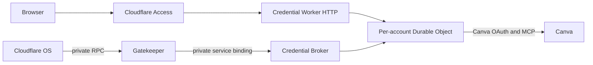

# Cloudflare Access and managed OAuth investigation

Researched 2026-10-16 for the `cloudflare-access-managed-oauth` branch. This
supersedes the previously deferred investigation; it does not change the approved
Canva resource API.

## Decision

Use Access for the public Workers' login and policy enforcement, and the native
Workers integration to identify the user completing a connection. Keep Canva's
delegated authorization in a separate credential Worker. Access managed OAuth
alone cannot replace the Canva token lifecycle. This branch removes that
lifecycle from the Gatekeeper bundle, rather than claiming it no longer exists.

| Responsibility | Owner in this branch | Can Access replace it? |
| --- | --- | --- |
| Browser login and policy for public HTTP requests | Cloudflare Access | Yes |
| OAuth authorization server for clients calling an Access app | Access managed OAuth | Yes; platform configuration, no custom server here |
| Resolve an authenticated HTTP user's identity | Native `ctx.access` | Yes; no application JWT verifier |
| Canva consent, code exchange, token refresh and provider revocation | Credential Worker | Not through managed OAuth alone |
| Cloudflare OS connection handoff and staged reconnect | Credential Worker and host | No documented replacement in Access |
| Resource confinement, observations and action approvals | Gatekeeper and host | No |

## What the referenced integration provides

The [referenced announcement](https://blog.cloudflare.com/workers-protected-by-access/)
describes attaching Access policies to a Worker, covering its associated domains
and previews, and reading authenticated identity using `ctx.access.getIdentity()`.
The [Workers Access documentation](https://developers.cloudflare.com/workers/configuration/cloudflare-access/)
adds a crucial boundary: the context belongs to a directly authenticated
invocation. It is not propagated through service-binding HTTP calls or RPC. It
also documents `access.dev` for local identity simulation.

We therefore check the native context and expected audience on public HTTP
requests. Connection flows require a stable human `user_uuid`; an email header,
raw JWT header, or service identity is not enough. The initial connection records
that Access principal, callbacks must match it, and reconnects must use the same
owner. The Access identity is not reported as a verified Canva email.

The privileged RPC entrypoints remain private capabilities held by Cloudflare OS
and the Gatekeeper. Requiring `ctx.access` in those methods would break the host
contract. Service bindings must only be granted to trusted Workers; the HTTP
guard does not authorize or restrict those bindings.

## What managed OAuth does

[Access managed OAuth](https://developers.cloudflare.com/cloudflare-one/access-controls/applications/http-apps/managed-oauth/)
lets compatible non-browser clients authenticate to an Access-protected
application. It supplies discovery and the authorization-code flow, checks Access
policies, and issues opaque client tokens. Cloudflare resolves those tokens and
forwards an authenticated assertion to the protected application. These are
credentials for the Access application, not a Canva API grant.

That means we do not need a custom OAuth authorization server for clients of our
own HTTP application. However, the original `auth/account.ts` code is an OAuth
**client of Canva**, plus the Cloudflare OS account-connection protocol. There was
no custom inbound OAuth server in the original implementation to delete.

The example Access application enables managed OAuth with short-lived tokens.
Dynamic-client redirects default to an empty allowlist; add exact HTTPS callback
URIs for approved clients before using it. No OAuth discovery, opaque-token
exchange, or refresh implementation is added to the Gatekeeper.

The resource API remains Workers RPC. Enabling managed OAuth does not turn it into
an HTTP MCP server, and does not allow a browser Access session to authorize a
later background RPC action on Canva by itself.

## Could an MCP portal remove Canva OAuth too?

Potentially, but it is a different architecture with different authority rules.
[MCP portals](https://developers.cloudflare.com/cloudflare-one/access-controls/ai-controls/mcp-portals/)
can broker upstream OAuth, including manually registered clients, and distinguish
portal authentication from each user's upstream authorization. This could move
Canva credential handling to Cloudflare's portal infrastructure.

The documented [service-token integration](https://developers.cloudflare.com/changelog/post/2026-06-26-mcp-portal-service-tokens/)
requires disabling per-user upstream authorization and using the server's admin
credential. Per-user servers are excluded from service-token sessions. Replacing
our per-account credentials with that mode would collapse the account boundary.
We did not make that substitution.

A per-user portal client is another possibility, but this Gatekeeper would still
need a documented way to establish and renew its portal authorization for durable
background actions. We found no documented `ctx.access` API that supplies a
refreshable upstream Canva credential to a later RPC invocation. Capturing and
replaying the HTTP identity assertion would not establish such a mechanism.

Before adopting a portal, validate Canva client approval, upstream scope behavior,
per-user account selection, token renewal without a live browser, revocation, and
the exact tool interface through the portal. A direct portal URL must also remain
private to the Gatekeeper's trusted transport; giving an agent raw access would
bypass its action queue. None of those portal/Canva behaviors were live-tested in
this branch.

## Implemented separation



- `src/index.ts` contains the resource API and Access-protected HTTP health route.
  It has no Canva client secrets, token storage, or OAuth callback.
- `auth/index.ts` serves Access-protected connection routes and a private
  `CredentialBroker` entrypoint. It has no public HTTP tool proxy or token endpoint.
- `auth/account.ts` retains the provider-specific OAuth client and the host's
  connection handoff. Account and callback stubs persist across Worker restarts.
- The Gatekeeper passes tool requests through the broker only after its existing
  scope, observation, and action rules. Tokens are never returned to resource
  sessions. A bundle test asserts that the Gatekeeper does not import `auth/`.

This is separation and platform-managed ingress authentication, not a reduction in
the total amount of Canva OAuth client code. A future credential broker backed by
a verified per-user managed service can replace that component without changing
the resource API.

## Configure and verify

1. Install both locked packages: `npm ci` and `npm ci --prefix auth`.
2. Configure the credential Worker's `BASE_URL` and Canva client, then deploy it
   before the Gatekeeper. For a first deployment, the placeholder audience causes
   public requests to fail closed until Access is configured. Existing deployments
   need the namespace migration plan described below.
3. Create a self-hosted Access application targeting both Workers by Worker ID.
   Start from [the example](../infra/access-application.example.json), replace its
   placeholders, and choose the operator allow policy. Worker destinations protect
   production and previews; a hostname-only policy could leave other URLs exposed.
4. Use the supported CLI for resource management. Discover it with
   `cf cli search "create Access application"`, inspect
   `cf zero-trust access applications create --help`, and submit the completed JSON
   with its `--body` option. For an existing app, retrieve and preserve its full
   configuration before updating; do not overwrite it with this create example.
5. Set `accessAudience` in `auth/cloudflare.config.ts` to the application's audience
   tag. Both Workers use it. Configure `BASE_URL` as the credential Worker's public
   HTTPS origin and register `<BASE_URL>/callback` with Canva.
6. Set Canva client secrets only on `canva-credentials`, using `cf` secret commands
   discovered through `cf cli search "Worker secrets"`. Local secrets belong in
   `auth/.dev.vars`. The Gatekeeper only receives the private `CREDENTIALS` service
   binding. Rebuild and redeploy both Workers with the configured audience.
7. Bind the host to the Gatekeeper's `GatekeeperVendor` entrypoint as before. The
   host must support persistent connection stubs and the existing handoff flow.

Local startup in separate terminals:

```sh
npm run dev:auth -- --mode access-dev
npm run dev -- --mode access-dev
```

The explicit `access-dev` mode supplies a fictional local identity. Without it,
local HTTP requests return 403. It creates no Access policy, proves no real login,
and must not be described as production protection. The example application JSON
is also configuration to provision, not a claim that Access has been enabled on
the account. The audience guard fails closed if the application is missing or
misconfigured.

Builds and checks:

```sh
npm run typecheck
npm test
npm run test:runtime
npm run test:access
npm run build
```

The new 17-check integration scenario runs actual separate Workers, a real DO
facet, persisted account/callback capabilities, and mocked Access identities and
Canva responses. It checks missing-context/header spoofing, one-use links and
callbacks, cross-user rejection, restart persistence, queued writes, observation
denial, reconnect, and revocation. Both `cf` production bundles and local health
routes were checked. It also exposed and fixed the default transport's unbound
native `fetch` receiver.

No Access resources were provisioned, no deployment occurred, and no live Canva
writes were repeated. The earlier live evidence applies to the original transport
and resource implementation, not a deployed Access configuration. Real Access
login/managed OAuth, the split deployment, full Cloudflare OS integration, and
Canva's newer self-serve endpoint remain unverified.

Moving `UserAccount` to another Worker creates a different DO namespace. This is
an undeployed experiment; no automatic migration is included. An existing
deployment must plan credential migration or create fresh connections, revoke old
provider grants, and retire the old namespace separately. Do not assume matching
object-ID strings transfer stored credentials.
